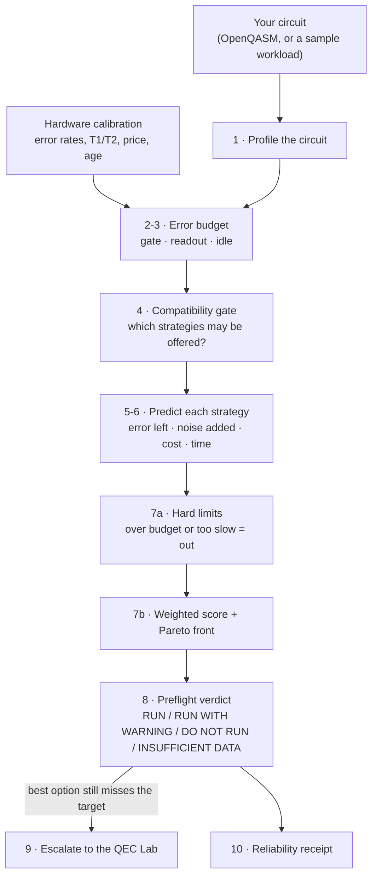

# Quantum Reliability Platform (QRP)

> Reliability intelligence for quantum workloads — analyze the circuit, evaluate the hardware,
> choose an error-management strategy, estimate the cost, and verify whether it actually helped.

### 🌐 Live prototype → **https://tss99.github.io/quantum-reliability-platform/**

QRP is a hardware-independent **reliability control plane** for quantum computing, spanning error
suppression → mitigation → detection → correction. The public deployment is a **static interactive
prototype on GitHub Pages** (seeded demo data / in-browser computation, no secrets, no server calls),
with a genuine **FastAPI backend** designed in-repo for local development and future deployment.

## What works today
A fully clickable prototype — every value is computed in-browser from seeded, deterministic demo data
(labelled illustrative/simulated, never presented as a hardware measurement):

- **New Analysis** — pick a workload → circuit analysis → reliability goal → an interactive **Pareto
  explorer** (cost vs error) → a RUN / RUN-WITH-WARNING / DO-NOT-RUN recommendation with an explainable
  score breakdown. The two-stage optimizer (hard-constraint pre-filter → weighted scoring) runs live.
- **QEC Lab** — a real **threshold plot** (logical vs physical error, d=3/5/7) read from a committed
  grid generated by **Stim + PyMatching (MWPM)** — the distance curves visibly cross at the threshold.
- **Hardware** — backend profiles with qubit **coupling maps** and a **calibration-drift monitor**.
- **Strategies**, **Workloads**, **Experiments + reliability receipts** (with JSON export), **Integrations**,
  **Settings** — dark-first, WCAG-checked, fully responsive.

## What is real vs simulated
| | |
|---|---|
| Real code | QEM engine, QEC engine (Stim/PyMatching), two-stage optimizer + preflight, domain schemas + invariants |
| Simulated / heuristic | error/cost/time estimates, hardware calibration, demo backends (all seeded + labelled) |
| Planned | live provider adapters (IBM/IQM/…), real QPU execution — behind backend adapters, never in the browser |

See [`docs/QA_AUDIT.md`](docs/QA_AUDIT.md), [`docs/ARCHITECTURE.md`](docs/ARCHITECTURE.md),
[`docs/MISSION.md`](docs/MISSION.md), and [`docs/DECISIONS.md`](docs/DECISIONS.md).

---

## How the platform works

This section explains, step by step, what QRP does with your circuit, why each step exists, and the
exact rule or formula behind it. Plain-language explanation first, the formula second.

- [What "applying" a mitigation technique means in QRP today](#what-applying-a-mitigation-technique-means-in-qrp-today)
- [The problem QRP solves](#the-problem-qrp-solves)
- [The pipeline at a glance](#the-pipeline-at-a-glance)
- [Step by step](#step-by-step) (profile → hardware → error budget → compatibility → prediction → cost → optimizer → preflight → QEC escalation → receipt)
- [A worked example](#a-worked-example)
- [Every strategy, explained](#every-strategy-explained)
- [Error correction: what the QEC Lab actually computes](#error-correction-what-the-qec-lab-actually-computes)
- [Two implementations of the model](#two-implementations-of-the-model)
- [Where the logic lives](#where-the-logic-lives)

### What "applying" a mitigation technique means in QRP today

QRP is a **planner**. It decides which mitigation strategy fits your circuit and hardware, predicts
how much error it will remove and what it will cost, and refuses the strategies that cannot work. It
does **not yet transform or execute** the circuit with that mitigation. There is no gate folding, no
pulse insertion and no readout-matrix inversion running anywhere in the code. The optional real-hardware
path (Tier 3, off by default) transpiles your circuit and submits it **unmitigated** through IBM's
`SamplerV2`.

That is why every predicted number in the app is labelled `heuristic` and why a reliability receipt
has an `observed_error_reduction` field that stays `null` until a real run fills it. A prediction is
never shown as a measurement.

### The problem QRP solves

Every quantum computer today is noisy. A gate occasionally does the wrong thing, a qubit loses its
state while it waits, and a measurement sometimes reads a 0 as a 1. Run a circuit and the number you
get back is pulled away from the true answer.

There are two families of fixes:

| | Error **mitigation** (QEM) | Error **correction** (QEC) |
|---|---|---|
| Idea | Run the circuit more times, or in deliberately altered ways, then use classical post-processing to estimate what the noiseless answer would have been | Encode one logical qubit in many physical qubits, keep checking for errors, and undo them as they happen |
| Works on today's hardware? | Yes | Only at small scale; needs hardware below a threshold error rate |
| Price | Extra shots (time and money) | Many extra qubits, plus a fast decoder |
| Limit | Can never bring the error to zero; reduces bias but adds statistical noise | Can push error arbitrarily low once below threshold |

Choosing well is hard. Each technique fixes only one kind of error, several break on certain circuit
features, and all of them cost something. QRP makes that choice for you, shows its reasoning, and
tells you plainly when mitigation cannot reach your target and you need error correction instead.

### The pipeline at a glance



### Step by step

#### 1. Profile the circuit

QRP reads your circuit and extracts only the features that change which strategy is safe or useful:

| Feature | Why QRP needs it |
|---|---|
| Two-qubit gate count | Two-qubit gates are roughly 10× noisier than single-qubit gates, so they usually dominate the error |
| Single-qubit gate count | Smaller contribution, still counted |
| Measured qubits | Each measurement adds readout error. Readout mitigation needs at least one |
| Depth | Longer circuits take longer, cost more and pick up more error |
| Idle exposure | Fraction of qubit-time spent waiting. Dynamical decoupling can only help here. `1 − busy_slots / (depth × qubits)` |
| Mid-circuit measurement, reset, classical feed-forward | These break the gate-folding trick ZNE relies on |

Input is bounded **before** parsing: 256 KB of source, 64 qubits, 20,000 gates, depth 5,000. Anything
larger fails fast with a reason code. In the browser, depth is a lower bound (`ceil(gates / qubits)`)
because there is no scheduler; the backend uses Qiskit's parser for an exact profile.

#### 2. Read the hardware

Every backend carries a calibration snapshot: two-qubit error rate, readout error rate, T1/T2, price
per QPU-second, and capabilities such as whether it accepts delay scheduling. The prototype ships three
seeded demo backends:

| Backend | Two-qubit error | Readout error | Price / QPU-s | Delay scheduling | Calibration age |
|---|---|---|---|---|---|
| Demo Hex-Lattice 27 | 0.82 % | 2.1 % | $1.60 | yes | 3.2 h (stable) |
| Demo Square-Grid 16 | 1.34 % | 3.0 % | $0.90 | yes | 14.5 h (watch) |
| Demo Ring 12 | 0.57 % | 1.6 % | $2.40 | **no** | 41.7 h (**stale**) |

Each backend has a 14-point calibration history with deliberate drift; QRP always uses the newest
point. A snapshot older than **24 h** raises a `CALIBRATION_STALE` warning, because a stale readout
calibration can make readout mitigation *add* error instead of removing it. With an IBM token on the
backend (Tier 1), real device calibration is read without running a job and labelled `measured`.

#### 3. Build the error budget

Think of the total error as water leaking from three separate pipes. Each mitigation technique can
only narrow one or two of them, so QRP keeps the pipes separate:

```text
gate    = n_2q × p_2q  +  n_1q × p_1q        (p_1q is taken as p_2q / 10)
readout = n_measured × p_readout
idle    = idle_exposure × gate × 0.5
λ       = gate + readout + idle               (total error "rate")
bias    = 1 − e^(−λ)
```

Why the exponential: for small λ the bias is about λ (errors just add up), and for large λ it
saturates at 1 (the observable has been completely scrambled). It turns an error count into a
number between 0 and 1.

#### 4. Compatibility gate: which strategies may be offered at all

Before anything is scored, each strategy is checked against the circuit and the backend. A strategy
gets one of three verdicts:

- **compatible**: offered.
- **conditional**: offered, with a stated precondition (for example "refresh the calibration first").
- **incompatible**: **never scored and never recommended**. It still appears in the "excluded" list
  with its reason, so you can see why it is missing.

Rules applied by the live (browser) engine:

| Strategy | Excluded when | Reason code |
|---|---|---|
| Dynamical decoupling, and ZNE + DD + readout | the circuit has zero idle exposure (DD would do nothing) | `UNSUPPORTED_CIRCUIT_FEATURE` |
| Dynamical decoupling, and ZNE + DD + readout | the backend does not support delay scheduling (Demo Ring 12) | `UNSUPPORTED_CIRCUIT_FEATURE` |
| Every ZNE variant | the circuit measures a qubit and then keeps operating | `UNSUPPORTED_CIRCUIT_FEATURE` |
| Surface code, d = 3 | always: no demo backend declares syndrome extraction | `QEC_CAPABILITY_MISSING` |

The backend's scientific engine uses a richer rule set, kept in one machine-readable file,
[`docs/data/qem_compatibility.json`](docs/data/qem_compatibility.json). Rules are checked top to
bottom and the first match wins. If a rule needs an input that is missing (an unknown T2, for
example), the answer is `INSUFFICIENT_CALIBRATION_DATA`. A missing value is never treated as zero.
The per-technique rules are listed in [Every strategy, explained](#every-strategy-explained).

Only **expectation-value** tasks (estimating an observable such as ⟨ZZ⟩) are supported. A
sampling-distribution task is refused with `TASK_TYPE_UNSUPPORTED` instead of being scored with a
model that does not apply to it.

#### 5. Predict what each strategy buys, and what it costs in noise

The key idea: **every mitigation technique trades bias for variance.** It removes some systematic
error (bias), but its post-processing amplifies shot noise (variance). QRP describes every strategy
with two kinds of number:

- a **residual factor** `r` per error pipe, between 0 and 1: the fraction of that pipe's error that
  remains. `r = 0.35` means 65 % removed; `r = 1` means the technique does nothing there.
- a **variance amplification** `V`: how much the technique inflates statistical noise. You would need
  `V`× more shots to get back to the unmitigated noise level.

```text
bias  = 1 − e^(−(r_gate·gate + r_readout·readout + r_idle·idle))
sigma = sqrt(V / shots)                 shots default to 20,000
rmse  = sqrt(bias² + sigma²)            the "expected error" QRP reports
```

Why report `rmse` and not bias alone: a technique that removes almost all bias but multiplies the noise
(PEC is the classic case) can leave you *worse off*. Reporting bias alone would hide that.

Each plan also carries two confidences that are deliberately never merged: `statistical_confidence`
(the 95 % level you asked for) and `strategy_confidence` (how far the model trusts the technique's
own assumptions; lower for ZNE and PEC than for raw or readout mitigation).

#### 6. Estimate cost and time

```text
seconds_per_shot = 0.5 ms (reset + readout)  +  depth × 0.4 µs
qpu_seconds      = shots × sampling_overhead × seconds_per_shot
cost_usd         = qpu_seconds × backend price per QPU-second
```

`sampling_overhead` is how many circuit executions a technique needs. ZNE with three noise levels runs
the circuit three times as often, so it costs about 3×.

#### 7. The two-stage optimizer

Every compatible strategy on every backend becomes a candidate plan. They are ranked in two stages,
and the order of the stages matters.

**Stage A — hard limits.** A plan over the cost cap (`COST_EXCEEDED`), over the runtime cap
(`MITIGATION_OVERHEAD_TOO_HIGH`), or not executable (PEC) is marked **infeasible** and gets
**no score at all**. Filtering *before* scoring means no weighting can rescue a plan you cannot afford.
Missing the error target is only a *warning* (`TARGET_ERROR_UNLIKELY`), because you may still want the
best plan that is available.

**Stage B — weighted score** over the plans that survived:

```text
error term = clamp(−log10(rmse) / 4)        rmse 1e-4 → 1.0 (best),  rmse 1 → 0.0
cost term  = 1 − cost / max_cost
time term  = 1 − seconds / max_runtime
score      = w_error·error + w_cost·cost + w_time·time         (higher is better)
```

| Priority preset | w_error | w_cost | w_time |
|---|---|---|---|
| Minimize cost | 0.25 | 0.55 | 0.20 |
| Balanced (default) | 0.40 | 0.35 | 0.25 |
| Maximize accuracy | 0.70 | 0.15 | 0.15 |

- The normalisation ranges are **fixed**, never min-max over the current batch. A plan's score does not
  change because some other plan was added or removed.
- Ties go to the cheaper plan, and the tie-break is flagged.
- Every term's contribution is shown, so "why did A beat B?" can be answered by reading the breakdown.
- The **Pareto front** marks the feasible plans that no other plan beats outright: nothing else is
  at least as cheap *and* at least as accurate while being strictly better on one of the two.

#### 8. Preflight verdict

The recommended plan's findings decide the verdict. The precedence is computed, never hand-set:

```text
INSUFFICIENT_DATA  >  DO_NOT_RUN  >  RUN_WITH_WARNING  >  RUN
```

| Verdict | Meaning |
|---|---|
| **RUN** | Clears every hard limit, no warnings |
| **RUN WITH WARNING** | Clears every hard limit, with something to acknowledge (target likely missed, stale calibration) |
| **DO NOT RUN** | A hard limit is violated. Nothing is executed and nothing is spent. A target miss of 10× or more is escalated to this |
| **INSUFFICIENT DATA** | A required input is missing, so no verdict is given. "Unknown" is never rounded to pass or fail |

Every finding carries one shared reason code (`COST_EXCEEDED`, `TARGET_ERROR_UNLIKELY`,
`CALIBRATION_STALE`, `MITIGATION_OVERHEAD_TOO_HIGH`, `UNSUPPORTED_CIRCUIT_FEATURE`,
`QEC_CAPABILITY_MISSING`, `INSUFFICIENT_CALIBRATION_DATA`, `TASK_TYPE_UNSUPPORTED`) and a suggested
next step.

#### 9. When mitigation is not enough: escalate to error correction

Mitigation has a floor. When even the best plan's `rmse` is above your target, New Analysis shows a
"QEM ceiling" card and carries your target, the hardware's physical error rate, and the circuit's size
into the QEC Lab.

The two worlds use different units. A QEM target is an error on an observable; QEC data is a logical
error rate per round of error checking. QRP converts between them openly, in three steps:

```text
P_fail ≤ ε / 2                     a corrupted result can swing ⟨O⟩ ∈ [−1, 1] by at most 2
N_L    = logical qubits × logical depth × rounds per layer      (d rounds per layer, d = 7)
p_L    ≲ P_fail / N_L              per-round budget (union bound, deliberately pessimistic)
```

For distances d = 3, 5 and 7 the QEC Lab then looks up the simulated logical error per round at your
physical error rate and gives each one a verdict:

- **meets target**: the 95 % *upper* confidence bound is inside the budget.
- **needs more statistics**: the point estimate is inside, the upper bound is not.
- **predicted miss**: even the point estimate is over budget.
- **no data**: your physical error rate is not on the simulated grid. QRP never borrows a neighbouring point silently.

It recommends the **smallest distance that meets the target**. Only a "meets" verdict is ever
recommended, because zero observed failures in a few shots is not proof of a low error rate.

#### 10. Reliability receipt

Each run produces a receipt you can export as JSON: workload, circuit fingerprint, backend, strategy,
raw vs processed error, cost and QPU time. It separates the **prediction**
(`predicted_error_reduction = 1 − rmse_strategy / rmse_raw`) from the **measurement**
(`observed_error_reduction`, which stays `null` until a real execution fills it). In demo mode the
actual cost and runtime are `null` by construction.

### A worked example

Take a small circuit (4 qubits, depth 12, 10 two-qubit gates, 20 single-qubit gates, 2 measured qubits,
idle exposure 0.3) on Demo Hex-Lattice 27 (p_2q = 0.82 %, p_readout = 2.1 %, $1.60 per QPU-second).
Use the default goal: target error 0.02, at most $80 and 600 s, 20,000 shots, Balanced priority.

**Error budget (raw):** gate = 10 × 0.0082 + 20 × 0.00082 = 0.0984; readout = 2 × 0.021 = 0.042;
idle = 0.3 × 0.0984 × 0.5 = 0.0148. So λ = 0.155 and bias = 1 − e^(−0.155) = 0.144.

| Strategy | Bias | Noise σ | rmse | QPU time | Cost | Stage A | Balanced score | Max-accuracy score |
|---|---|---|---|---|---|---|---|---|
| Raw | 0.144 | 0.007 | 0.144 | 10 s | $16.15 | feasible | 0.609 | 0.415 |
| Readout (tensored) | 0.116 | 0.008 | 0.117 | 12 s | $18.58 | feasible | 0.607 | **0.426** |
| DD (XY4) | 0.136 | 0.007 | 0.136 | 10 s | $16.15 | feasible | **0.612** | 0.419 |
| ZNE Richardson ×3 | 0.087 | 0.018 | 0.089 | 30 s | $48.46 | feasible | 0.480 | 0.385 |
| ZNE exponential ×5 | 0.081 | 0.030 | 0.086 | 50 s | $80.77 | **infeasible** (cost) | — | — |
| ZNE + DD + readout | 0.049 | 0.019 | **0.053** | 35 s | $55.73 | feasible | 0.470 | 0.411 |
| PEC | 0.033 | 0.077 | 0.083 | 1,191 s | $1,906 | **infeasible** (cost, time, not executable) | — | — |

What this shows:

1. **Stacking works on bias.** ZNE + DD + readout attacks all three pipes and has the lowest error, 0.053, about 2.7× better than raw.
2. **Bias vs variance is real.** PEC has the lowest bias (0.033), but its noise σ = 0.077 makes its total error worse than the stacked strategy, and it costs over 20× the budget.
3. **The hard filter runs first.** ZNE ×5 misses the $80 cap by 77 cents, so it is never scored, however accurate it is.
4. **The weights decide the winner.** Because the error term is on a log scale, cutting error 2.7× adds about 0.11 to the normalised error term, while the 3.45× higher cost subtracts about 0.5 from the cost term. Under Balanced the cheap DD plan wins, and even under Maximize accuracy readout-only edges out the stacked plan. That is a consequence of the current weights and normalisation, not a physics result, and it is why the Pareto chart is shown next to the ranking.
5. **Nothing reaches 0.02.** The verdict is RUN WITH WARNING (no plan misses by 10× or more), and the QEM-ceiling card appears. The QEC budget becomes P_fail = 0.01, N_L = 4 × 12 × 7 = 336, so p_L ≲ 3.0 × 10⁻⁵ per round.

These numbers are computed by hand with the live engine's formulas on one backend. The app ranks
across all three backends and uses the newest drifted calibration point, so its numbers will differ
slightly.

### Every strategy, explained

Each entry covers what the technique fixes, how it works, what it costs, when QRP refuses it, and how
QRP models it. "Live" is the browser engine that runs on the public site; "backend" is the scientific
engine in `services/api/app/qem/` (see [Two implementations](#two-implementations-of-the-model)).
The "refused when" and "conditional when" lists are the backend rule set; the live engine applies the
subset shown in step 4.

#### Raw (no mitigation): the baseline

- **Why it exists:** every claimed improvement needs something to be compared against. Raw is always offered.
- **Model:** r = 1 on every pipe, V = 1, overhead 1×.

#### Readout error mitigation

- **Fixes:** measurement errors, where the device reads 0 as 1 or the other way round.
- **How it works:** run simple calibration circuits that prepare known states, measure how often each
  qubit is misread, and build an *assignment matrix*. Applying its inverse to your measured counts
  undoes the misreads statistically. QRP uses the *tensored* method (one small matrix per qubit) or
  *M3*. A dense 2ⁿ × 2ⁿ inversion is never offered, because it grows exponentially.
- **Cost:** small. Live overhead 1.15×. Inverting the matrix also amplifies noise, by
  `(1 − 2·p̄_readout)^(−2n)` for n measured qubits (backend model).
- **Refused when:** nothing is measured; the backend has no readout calibration data.
- **Conditional when:** the calibration is older than 24 h (a stale matrix can add bias); more than 10
  qubits are measured (tensored or M3 only); the task is a sampling distribution (raw inversion can
  produce negative "probabilities", so a projection step is required).
- **Model:** readout r = 0.25 live (0.10 backend). Gate and idle errors are untouched.

#### Dynamical decoupling (DD, XY4 sequence)

- **Fixes:** errors that build up while a qubit sits idle (dephasing, crosstalk).
- **How it works:** fill the idle windows with a sequence of pulses (X, Y, X, Y) that multiply to the
  identity, so the computation is unchanged. Slow noise that pushes the qubit one way during the first
  half is reversed during the second half and largely cancels, like an echo.
- **Cost:** free in shots (1×). It only needs a backend that accepts timed delay instructions.
- **Refused when:** the circuit has no idle time (DD would do nothing, and QRP never offers a
  zero-benefit technique); the backend has no delay or scheduling support.
- **Conditional when:** idle exposure is below 5 % (benefit smaller than the model's own uncertainty);
  the circuit has mid-circuit measurements (sequences must not straddle a measurement).
- **Model:** idle r = 0.35 live (0.40 backend). Gate and readout errors are untouched.

#### Pauli twirling (randomized compiling): a modifier, not a strategy

- **Fixes:** nothing on its own. It reshapes the noise so other techniques work better.
- **How it works:** wrap each noisy gate in random Pauli gates chosen to cancel out in the ideal
  circuit. Averaged over many random instances, *coherent* errors (systematic over-rotations that can
  build up quadratically) turn into simple random *Pauli* errors that grow smoothly and predictably.
- **Why QRP only uses it with ZNE:** ZNE assumes noise grows smoothly as it is amplified; twirling makes
  that assumption roughly true. On its own, or paired only with readout mitigation, it gives no bias
  benefit, so "twirling + readout" is deliberately never generated.
- **Cost:** shots are split across instances (default 16, range 8 to 64), not multiplied. If the
  instances exceed the backend's circuits-per-job limit they are spread over more jobs.
- **Model:** r = 1 everywhere. In the backend engine, ZNE without twirling has its strategy confidence
  multiplied by 0.7.

#### Zero-noise extrapolation (ZNE)

- **Fixes:** gate errors, the biggest pipe for most circuits.
- **How it works:** you cannot remove the noise, but you can *add* more in a controlled way. Gate
  folding replaces the circuit U with `U (U† U)^k`. Logically that is still U, because U†U is the
  identity, but it runs `λ = 2k + 1` times as many gates, so the noise is scaled by λ = 1, 3, 5. Measure
  the observable at each noise level, fit a curve through the points (Richardson or linear in the
  backend; Richardson or exponential in the live catalog), and read off where the curve would be at
  **zero** noise.
- **Cost:** one circuit execution per noise level (3× for three scale factors, 5× for five).
  Extrapolation also amplifies noise: V = 5.0 for factors (1, 3) and V = 15.7 for (1, 3, 5) in the
  backend; V = 6.5 (Richardson ×3) and V = 18 (exponential ×5) live.
- **Refused when:** the task is not an expectation value; the circuit contains a mid-circuit
  measurement, a reset, or classical feed-forward. Folding works only because U†U is the identity,
  and a measurement or reset is not reversible, so the folded circuit would be a different computation.
- **Conditional when:** the most-folded circuit would exceed the backend's depth limit (drop to (1, 3));
  the most-folded circuit would run longer than the median T2. At that point the signal has decayed
  toward zero, the extrapolation is anchored on a dead point, and ZNE can end up *worse* than raw.
- **Model:** live uses a fixed gate r = 0.35 (×3) or 0.28 (×5). The backend computes it from the noise
  level: `r = min(1, (λ_max · E_coherent)^(m − 1))` with m scale factors. Low noise leaves little
  residual; high noise makes extrapolation useless (r → 1). Readout error is never touched by folding,
  because it happens once at the end however long the circuit is.

#### Stacked strategies and why order matters

| Combination | Verdict | Required order |
|---|---|---|
| DD + readout | compatible | Independent: DD is applied at compile time, readout correction afterwards |
| ZNE + readout | compatible | Correct readout **at each noise level, then** extrapolate. Readout error does not grow with folding, so correcting after extrapolating would be wrong |
| ZNE + twirling | compatible | Fold first, then twirl each folded circuit separately |
| DD + ZNE | conditional | Fold first, re-schedule the folded circuit, **then** insert DD into its new idle windows |
| DD + ZNE + readout | conditional | fold → re-schedule → insert DD → twirl → run → readout-correct per scale factor → extrapolate |
| Twirling + readout | incompatible | Never generated: twirling has nothing to feed into |
| PEC + anything | incompatible | PEC never executes in this version |

When two techniques act on the same pipe, QRP takes the **larger** (more conservative) residual
rather than multiplying them: correcting a channel twice does not make it twice as good. A technique
that does nothing on a pipe (r = 1) is ignored for that pipe.

#### Probabilistic error cancellation (PEC): a cost calculator only

- **Idea:** write each ideal gate as a weighted mix of noisy operations the device can actually run,
  with some weights negative. Sample from that mix and re-weight the results; on average the noise
  cancels exactly. In principle it is unbiased.
- **The catch:** the negative weights blow up the variance. The shot multiplier is γ², where
  `γ = ∏ (1 + ε_g) / (1 − ε_g)` over every gate g. It grows exponentially with circuit size.
- **What QRP does:** shows the γ² number so the cost is visible, never offers PEC as a runnable plan,
  and never recommends it. If γ² is over 10,000 the backend reports the number and marks PEC
  infeasible outright. Without per-gate error rates it shows "Not provided", never zero.

#### Declared but not built

Clifford data regression (CDR), probabilistic error amplification (PEA), symmetry verification and
post-selection appear in the strategy explorer with the verdict *not implemented* and the specific
missing ingredient (training circuits, a learned noise model, a declared symmetry, check ancillas).
They are never scored.

### Error correction: what the QEC Lab actually computes

Unlike the QEM numbers, the QEC curves are **real simulation results**, not heuristics.

- **Codes:** the repetition code (protects against one error type only) and the rotated surface code
  (protects against both). Physical qubits per logical qubit: `2d − 1` for repetition (5, 9, 13) and
  `2d² − 1` for the surface code (17, 49, 97 at d = 3, 5, 7).
- **Noise models**, from simplest to most realistic, all driven by one knob p:
  *code capacity* (only data qubits fail), *phenomenological* (measurements fail too), and
  *circuit level* (resets and every two-qubit gate fail too).
- **How a point is produced:** Stim builds the syndrome-extraction circuit (d rounds; 1 round for code
  capacity) and its detector error model. PyMatching decodes every shot with minimum-weight perfect
  matching (MWPM): it finds the most likely set of errors consistent with the checks that fired. A
  *logical error* is a shot where the decoder's correction still flips the encoded answer. Sampling
  stops at 100,000 shots or 1,000 logical errors, whichever comes first.
- **Statistics:** the logical error rate `k / n`, a 95 % **Wilson** confidence interval (correct even
  with zero failures, where the naive interval collapses), and the per-round rate
  `p_round = (1 − (1 − 2·P_L)^(1/rounds)) / 2`. It is reported as null past P_L = 0.5, where the code is
  no better than a coin flip. Fewer than 50 observed errors is flagged as insufficient statistics.
- **Threshold:** plot logical error against physical error for d = 3, 5, 7. Below the crossing point,
  a bigger code is better; above it, a bigger code is worse. For the repetition code the crossing is
  only a bit-flip *pseudo*-threshold, and the UI says so.
- **Reproducibility:** the committed grid in [`demo-data/qec/`](demo-data/qec/) holds 216 threshold
  points (2 codes × 3 distances × 3 noise models × 12 p values). It was generated by
  `scripts/generate_qec_fixtures.py` with a fixed master seed, and the Stim/PyMatching versions are
  recorded in the manifest. `POST /api/v1/qec/simulate` runs a fresh point on the local backend.
- **Decoders:** MWPM is the only real decoder. Union-Find, BP, BP+OSD, majority vote and GPU decoding
  are listed as `NOT_IMPLEMENTED` and return null for every metric, never an estimate.

### Two implementations of the model

The same pipeline exists twice, and they are not numerically identical:

| | Live engine (what the public site runs) | Backend scientific engine |
|---|---|---|
| Code | `apps/web/src/services/demoEngine.ts` | `services/api/app/qem/` + `services/api/app/optimization/` |
| Compatibility rules | Four hand-coded checks (step 4) | Full rule set from `docs/data/qem_compatibility.json` |
| Readout residual | 0.25 | 0.10 |
| DD residual | 0.35 | 0.40 |
| ZNE residual | Fixed (0.35 / 0.28) | Computed from noise level and scale factors |
| Error score term | Log scale, `−log10(rmse)/4`, higher is better | Linear, `rmse / 0.5`, total = `1 − Σ w·term` |
| Wired to | The UI on GitHub Pages | Unit tests. `POST /strategies/optimize` takes candidates that are already costed, and the `qem/` estimator is not yet called by any endpoint |

The constants in both are documented, configurable, heuristic values, not universal physical
constants. Unifying the two engines is open work.

### Where the logic lives

| Concern | File |
|---|---|
| Live error budget, prediction, optimizer, preflight, Pareto | `apps/web/src/services/demoEngine.ts` |
| Live strategy catalog and demo backends | `apps/web/src/services/demoFixtures.ts` |
| In-browser OpenQASM parsing | `apps/web/src/services/qasm.ts` |
| QEM → QEC unit conversion | `apps/web/src/services/qecBudget.ts` |
| Compatibility rules (single source of truth) | `docs/data/qem_compatibility.json` |
| Rule evaluator, strategy catalog, bias/variance model | `services/api/app/qem/matrix.py`, `catalog.py`, `model.py` |
| Two-stage optimizer and weight presets | `services/api/app/optimization/engine.py`, `weights.py` |
| Reason codes and verdict precedence | `services/api/app/domain/reason_codes.py` |
| Stim + PyMatching simulation, Wilson statistics | `services/api/app/qec/simulate.py`, `statistics.py` |
| Server-side OpenQASM parsing with hard limits | `services/api/app/circuits/qasm.py` |
| IBM calibration (Tier 1) and guarded job submission (Tier 3) | `services/api/app/providers/ibm.py`, `ibm_jobs.py` |
| Background and derivations | [`docs/QEM_METHODS.md`](docs/QEM_METHODS.md), [`docs/QEC_METHODS.md`](docs/QEC_METHODS.md), [`docs/SCIENTIFIC_ASSUMPTIONS.md`](docs/SCIENTIFIC_ASSUMPTIONS.md) |

## Quality
~160 automated tests, 0 known vulnerabilities: **140** backend `pytest` · **14** frontend Vitest ·
**6** Playwright E2E (flows A–D + regression) · `npm audit` clean · CSP-enforced, no secrets in the bundle.

## Local API
The FastAPI backend exposes the engines over REST (local only — Pages is static by design):
`GET /health`, `GET /api/v1/backends[/{id}[/calibration]]`, `POST /api/v1/circuits/analyze`,
`POST /api/v1/strategies/optimize`, `POST /api/v1/preflight`, `POST /api/v1/qec/simulate`.
Interactive docs at `/docs`. See [`docs/DEPLOYMENT.md`](docs/DEPLOYMENT.md).

## Repository layout
- `apps/web/` — React + TypeScript (strict) + Vite + Tailwind frontend (the deployable prototype)
- `services/api/` — FastAPI backend: `qem/`, `qec/`, `optimization/`, `schemas/`, `domain/` (modular monolith)
- `packages/contracts/` — generated TS/Zod contracts (from the backend OpenAPI schema)
- `demo-data/` — deterministic, seeded demo datasets (incl. the QEC threshold grid)
- `docs/` — product, architecture, scientific, design, and process documentation

## Getting started
```bash
# Frontend (the prototype)
cd apps/web && npm ci
npm run dev            # local dev server
npm run test          # Vitest
npm run build         # production build
npm run e2e           # Playwright flows A–D (needs: npx playwright install chromium)

# Backend (local dev / future)
cd services/api && pip install -e ".[dev]"
pytest -q             # 132 tests
uvicorn app.main:app --reload   # GET /health
```

Deployment is automated: pushing to `main` builds `apps/web` and publishes it to GitHub Pages
(`.github/workflows/pages.yml`). The Vite `base` path is parameterised via `VITE_BASE_PATH`.
